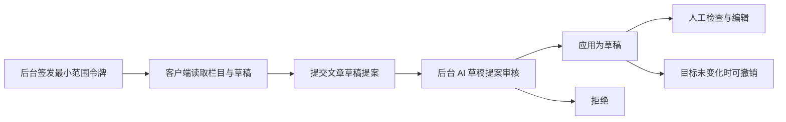

# AI 外部访问与草稿提案

## 开始前

先完成数据库迁移，再由超管打开后台「AI 外部访问」并准备连接。默认关闭；普通账号需被授予 `ai_access`，文章提案还需文章编辑权限。演示站与支持账号不能使用外部访问。

每个客户端单独签发一个令牌，选最少的范围。默认仅勾读取范围；提交提案与查看状态需主动勾选。令牌明文只显示一次，请保存在客户端的私有凭据配置中，不贴到聊天、日志或截图里。

## 连接与提案流程

客户端地址使用后台显示的完整 HTTPS 地址，末尾保留 `/mcp/`。Apache 下无结尾斜杠可能触发 301，导致 POST 被改成 GET。子目录站也要保留站点前缀。

客户端可读取站点信息、文章栏目、文章、普通单页与产品，提交文章草稿、单页内容或产品文案提案，并查询提案状态。没有外部发布、应用、撤销工具。提交提案本身不会修改页面、产品或创建文章，应用后始终是未发布草稿。

## 普通单页内容

单页读取需显式授予 `page_read` 范围，提交修改还需 `page_content_propose`；账号同时需要 `ai_access`、`blox_edit` 和 `edit_page` 权限。旧令牌不会自动增加范围。首页、页头页脚、模板与停用单页不在此功能范围内。

先调用 `page_list` 找到普通单页，再用 `page_read` 读取其内容。翻页时携带第一次返回的 `page.base_revision`；修订号变化时从头读取。修改使用元素稳定 ID 与该修订号，最多提交 50 个改动。目前只支持标题文字、正文 HTML 与图片替代文字，不支持图片替换、链接字段、样式或结构操作。HTML 会经过清理，动态绑定及循环模板中的字段不允许修改。

后台「预览」仅对登录且有权限的提案本人开放，不保存内容、不创建公开草稿地址。预览与应用都会检查当前版本。单页提案作为一项原子操作应用到草稿，已发布版本保持不变。撤销要求草稿仍是 AI 应用后的版本；如已人工修改或该版本已发布，撤销会被拒绝。页面提案与文章提案共用当前每账号 200 个待审项额度。

## 产品文案

产品读取需显式授予 `product_read` 范围（含 `product_list` 与 `product_read` 两个工具），提交修改还需 `product_content_propose`；账号同时需要 `ai_access` 和 `edit_product` 权限。读取结果把标题、型号、参数、分类等事实字段放在只读的 `facts` 里，不返回价格、图片与后台字段。

只能提交摘要、详情 HTML 与 SEO 标题、关键词、描述；带上标题、型号、参数、价格、状态等任何其他字段，整次提交都会被拒绝。只有未发布的产品草稿可以提案（例如批量翻译生成的译文草稿），已发布产品只能读取。每项需带上 `product_read` 返回的 `base_revision`；产品之后被人工保存、改过 SEO、发布或删除，提交与应用都会拒绝。应用只写提案里的字段，不改发布状态；撤销要求产品仍是 AI 应用后的版本。产品没有历史版本，改前值保存在 AI 变更记录里供撤销。

重试同一次提交时使用相同幂等键和相同内容；服务返回同一提案，不重复创建。不同内容必须使用新键。同键不同内容会被拒绝，不能用它覆盖旧提案。

## 审核与撤销

后台助手的「生成 SEO 摘要」也会先暂存。生成时固定摘要与来源版本，应用时不再调用模型；原正文、标题或状态已变化时需重新生成。旧版不完整的 SEO 暂存不能直接应用。

在「AI 草稿提案」页查看自己的提案，对照当前值与建议值。可以按项应用、批量选择或拒绝。拒绝与撤销采用页面内两步按钮，不调用浏览器原生确认框。

提案提交后若原文章已被编辑、发布、删除或发生其他版本变化，应用会拒绝冲突项；其他选中项仍可独立处理。不要通过反复点击规避冲突，先核对当前内容再重新提案。

撤销仅在目标仍与 AI 应用后的版本一致时执行。人工编辑后会拒绝撤销，避免覆盖新内容。AI 新建草稿的撤销是移入回收站；修改已有草稿会恢复原字段。修改和撤销都进入文章历史版本，保留条数沿用站点设置。

## 关闭与排错

- 临时停用：超管关闭 AI 外部访问，原有后台继续使用；恢复开关前检查仍有效的令牌。
- 丢失或泄露：撤销对应令牌并重新签发。通过后台停用或删除账号时，其令牌会一并撤销。
- 401：检查令牌是否正确、过期或撤销，以及 Apache 是否传递 Authorization。
- 403：检查开关、权限、账号状态、HTTPS 和可信代理设置。
- 429：稍后再试；读取、提案和待审队列配额分别限制，不要持续自动重试。
- 503：检查数据库与日志存储，或配置变更后重新准备私有桥接。
- Apache 大正文：`FcgidMaxRequestLen` 至少设为 262144，详见部署说明；反向代理也须允许相应请求体。

完整数据库备份包含令牌摘要、审计和提案内容，应按敏感备份保管。私有桥接含数据库连接资料，不能放进发行包或支持材料。首次试用应在隔离测试站进行；本说明不代表生产发布授权。
